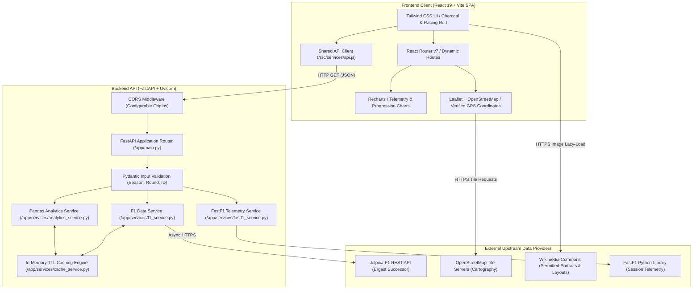

# 🏎️ Racepective — Formula 1 Analytics Platform

> **“See racing differently.”** — An independent, beginner-friendly Formula 1 race intelligence and analytics web application engineered for software engineering and data analytics portfolio showcase.


---

## 🎯 Overview

**Racepective** makes Formula 1 accessible, visually intuitive, and analytically grounded for casual motorsport fans, prospective analysts, and engineering recruiters alike. It translates complex championship telemetry, qualifying times, pit stops, and race classifications into high-contrast motorsport dashboards without copying the official F1 app interface.

### Key Capabilities
- **Live Home Dashboard**: Next Grand Prix countdown timer, previous race winner spotlight, driver & constructor championship leaders, compact driver standings, recent results, and an embedded championship progression chart.
- **Race Calendar**: Complete season schedule with `Upcoming`, `Completed`, and `In Progress` status filters, track locality, country, circuit metadata, and direct race-detail navigation.
- **Grand Prix Classifications**: Detailed race results, interactive Leaflet mini map with real GPS track coordinates, podium finisher showcases, starting grid vs finish position deltas, fastest lap indicators, and qualifying lap times.
- **Driver Standings & Head-to-Head Comparison Engine**: Full championship classification with points share bars and an interactive comparison tool evaluating any two drivers side-by-side.
- **Constructor Standings**: Team rankings, points, wins, driver lineups, and championship points share visualizers.
- **Driver Profiles**: Individual driver pages featuring career statistics, car numbers, nationalities, birthdates, race logs, and an inverted-axis finishing position trend chart.
- **Geospatial Circuit World Map & Directory**: Interactive Leaflet world map with verified WGS84 geographic coordinates (`lat/long`), custom red motorsport markers, popups, and OpenStreetMap tiles across host venues, paired with an accessible, keyboard-navigable directory.
- **Dedicated Circuit Profiles (`/circuits/:circuitId`)**: Individual track venue pages with high-zoom OpenStreetMap location maps, verified technical specifications (track length, corner counts, pole conversion rate), host Grand Prix history, and authentic circuit track layout outlines.
- **Genuine Intelligence & Analytics Suite (`/insights`)**:
  1. **Championship Progression**: Cumulative round-by-round points accumulation for title contenders with interactive driver filter toggles and deterministic lead margin insights.
  2. **Head-to-Head Points Gap**: Dynamic round-by-round differential curve (`Points(A) − Points(B)`) with lead change counters, maximum advantage tracking, and scoring rule explanations.
  3. **Finishing-Position Trends**: Grid start vs classified finish trajectory over completed races, with explicit tracking of DNS, DNF, and DSQ results.
  4. **Driver Consistency & Volatility**: Average classified finishing positions, sample standard deviation ($\pm \sigma$), DNF rates, and a 0–100 consistency index with methodological notes distinguishing finish volatility from car pace.
  5. **Teammate Head-to-Head Battles**: Intra-team metrics comparing points share, classified race finishes, qualifying session head-to-heads, podiums, and victories.
  6. **Constructor Points Breakdown**: Stacked driver contribution charts showing exact points and percentage shares per constructor.
  7. **Circuit Historical Legacy**: Authentic all-time track records from Jolpica, detailing winning drivers, constructors, and pole-to-win conversion rates.
  8. **Race Result Explainer**: Deep dive into individual Grand Prix results showing net position changes, pit lane starts, retirements, and biggest movers.

---

## 🏛️ System Architecture



---

## 🏗️ Tech Stack

| Domain | Technology | Purpose |
|---|---|---|
| **Frontend Framework** | React 19 + Vite 8 | Single Page Application with optimized bundle splitting |
| **Styling** | Tailwind CSS v4 | Dark charcoal navigation (`#121417`), warm off-white canvas (`#F8F9FA`), restrained racing-red accents (`#E10600`) |
| **Routing** | React Router v7 | Client-side routing with clean URLs and parameter validation |
| **Data Visualization** | Recharts 2 | Responsive interactive SVG charts with tooltips and custom legends |
| **Cartography & Maps** | Leaflet 1.9 + React-Leaflet | OpenStreetMap tiles, custom motorsport markers, and dynamic map fly-to |
| **Backend Framework** | Python 3.12 / 3.14 + FastAPI | Asynchronous REST API with Pydantic validation |
| **Server Engine** | Uvicorn | High-throughput ASGI production server |
| **Data Processing** | Pandas 2.2 + NumPy 1.26 | Pure deterministic statistical calculations, consistency std dev, teammate ratios |
| **Upstream Data** | Jolpica-F1 Community API | Open-source successor to Ergast for schedules, standings, results |
| **Session Telemetry** | FastF1 | Supplementary session weather and timing data |
| **Caching Engine** | In-Memory TTL Cache | Sliding TTL caching (10 min schedule / 24 hr historical) to protect upstream APIs |
| **Testing** | Pytest 8 | 23-test analytical math and API endpoint verification suite |

---

## 🔌 API Endpoints Reference

| Endpoint | Method | Description |
|---|---|---|
| `/api/health` | `GET` | System status, active season, Jolpica connectivity, and timestamp |
| `/api/seasons` | `GET` | List of all available F1 world championship seasons (1950–present) |
| `/api/seasons/{year}/races` | `GET` | Race schedule for specified season with verified states |
| `/api/races/next` | `GET` | Immediate next scheduled Grand Prix with countdown metadata |
| `/api/races/latest` | `GET` | Most recently completed Grand Prix classification and podium |
| `/api/races/{year}/{round}` | `GET` | Grand Prix results, qualifying grid, and session timetable |
| `/api/races/{year}/{round}/telemetry` | `GET` | Supplementary session weather & telemetry via FastF1 |
| `/api/standings/drivers/{year}` | `GET` | Driver championship standings for a given year |
| `/api/standings/constructors/{year}` | `GET` | Constructor championship standings for a given year |
| `/api/drivers` | `GET` | Full grid of active drivers with team allocations and stats |
| `/api/drivers/{driver_id}` | `GET` | Driver identity, stats, team, and season record |
| `/api/drivers/{driver_id}/results/{year}` | `GET` | Race-by-race finishes for a specific driver in a season |
| `/api/circuits` | `GET` | All circuits with GPS coordinates for Leaflet maps |
| `/api/circuits/{circuit_id}` | `GET` | Specific circuit information and locality metadata |
| `/api/circuits/{circuit_id}/history` | `GET` | All-time winners, top constructors, and pole conversion rate |
| `/api/dashboard` | `GET` | Aggregated payload powering the Home overview |
| `/api/analytics/progression` | `GET` | Cumulative points progression with lead margin insights |
| `/api/analytics/points-gap` | `GET` | Differential gap between any two drivers with lead changes |
| `/api/analytics/finishing-trends` | `GET` | Grid start vs finish trajectory with DNF/DNS handling |
| `/api/analytics/driver-consistency` | `GET` | Mean classified finish, std dev (variability), and DNF rates |
| `/api/analytics/teammate-comparison` | `GET` | Head-to-head race finishes, qualifying duels, and point shares |
| `/api/analytics/constructor-contributions` | `GET` | Cumulative points and driver percentage contribution breakdown |
| `/api/analytics/race-explainer` | `GET` | Grid vs finish position changes, overtakes, and retirements |

---

## 🛡️ Truth in Racing Data & Legal Integrity

1. **Race Status Veracity**:
   - Scheduled future events are strictly labeled `UPCOMING` with countdown timers; they are **never** treated as completed or live.
   - An event is only marked `IN_PROGRESS` if current UTC time falls between official session start and start + 3 hours.
   - Official race results are required to mark an event `COMPLETED`.
2. **Explicit Demo Labelling**:
   - If the upstream API is unavailable or rate-limited, responses carry `"is_demo": true` and `"upstream_available": false`. The UI visibly renders a `DEMO MODE` badge and last-updated timestamp; it never silently fabricates live results.
3. **Asset Licensing & Provenance**:
   - Driver portraits and circuit layout outlines are sourced from **Wikimedia Commons** under **Creative Commons** (`CC BY-SA 4.0`, `CC BY 2.0`, `CC0`) and the **Open Government Licence v3.0**.
   - Photographers and license terms are credited directly on driver profiles and circuit inspector cards.
   - **Zero AI-generated portraits** and **no scraped proprietary images**.
   - When an image fails to load or is unverified, `<DriverAvatar />` displays a graceful initials monogram with team accent colors, and `<CircuitOutline />` displays an honest location notice.
4. **Non-Affiliation Disclaimer**:
   - Racepective is an independent, non-commercial portfolio showcase. It is not affiliated with, endorsed by, or sponsored by Formula One Licensing B.V., Formula One Management (FOM), the FIA, or any Formula 1 team. F1, FORMULA ONE, FORMULA 1, GRAND PRIX, and related trademarks belong to Formula One Licensing B.V.

---

## 🧪 Automated Testing

Racepective includes a 23-test analytical math and API endpoint verification suite:

```bash
cd backend
py -3.14 -m pytest tests/ -v
```

### Coverage Highlights:
- **Net Places Gained/Lost Calculation**: Correct handling of position gains, losses, maintained positions, unclassified retirements, classified retirements (>90% distance), DNS, DSQ, and pit lane starts (`grid == 0`).
- **Cumulative Points Aggregation**: Iterative accumulation and empty set handling.
- **Points Gap Differential**: Lead change counters, maximum advantage tracking, and round deltas.
- **Driver Consistency & Volatility**: Sample standard deviation ($\sigma$), mean finish, DNF rates, and consistency index calculation.
- **REST Endpoints & Input Validation**: 400 Bad Request verification for out-of-bounds seasons (<1950 or >2030), invalid rounds (<1 or >35), and malformed IDs.

---

## 🚀 Exact Windows Setup & Running Locally

### 1. Prerequisites
- **Node.js**: v18.0.0 or higher ([Download Node.js](https://nodejs.org/))
- **Python**: v3.10.0 or higher ([Download Python](https://www.python.org/))

---

### 2. Backend Setup & Startup

Open PowerShell terminal #1:

```powershell
# Navigate to the backend directory
cd C:\Users\sures\.gemini\antigravity\scratch\gridlens\backend

# (Optional) Create and activate a Python virtual environment
py -m venv venv
.\venv\Scripts\Activate.ps1

# Install required Python dependencies
pip install -r requirements.txt

# Run the automated test suite
py -m pytest tests/ -v

# Launch the FastAPI backend server with hot reload
uvicorn app.main:app --host 127.0.0.1 --port 8000 --reload
```

The backend API will run at `http://127.0.0.1:8000`. Interactive OpenAPI documentation is available at `http://127.0.0.1:8000/docs`.

---

### 3. Frontend Setup & Startup

Open PowerShell terminal #2:

```powershell
# Navigate to the frontend directory
cd C:\Users\sures\.gemini\antigravity\scratch\gridlens\frontend

# Install Node dependencies
npm install

# Verify the production build
npm run build

# Start the local Vite development server
npm run dev
```

Open your browser to `http://localhost:5173`.

---

## 🌐 Production Deployment Guide

Deploying Racepective requires deploying **both** the backend and the frontend. The React frontend is a Single Page Application (SPA) that queries the FastAPI backend over HTTPS.

> [!IMPORTANT]
> The frontend communicates with the backend via `VITE_API_BASE_URL`. Because Vite embeds `VITE_*` variables during the build process, `VITE_API_BASE_URL` must be provided as a build-time environment variable pointing to your deployed backend URL (e.g. `https://racepective-api.onrender.com/api`). **Never put API keys or secrets in frontend environment variables.**

### Architecture Requirements
1. **Backend Service**: Requires a Python ASGI hosting runtime (e.g. Render Web Service, Railway, Fly.io, or Docker container).
2. **Frontend Service**: Can be hosted on any static site CDN (e.g. Render Static Site, Vercel, Netlify, or Nginx container).
3. **CORS Configuration**: The backend's `CORS_ORIGINS` environment variable must include your live frontend URL.

---

### Option A: 1-Click Blueprint on Render (`render.yaml`)

Racepective includes a pre-configured `render.yaml` blueprint in the repository root.

1. Push your Racepective repository to GitHub or GitLab.
2. In the [Render Dashboard](https://dashboard.render.com/), click **New** > **Blueprint**.
3. Connect your repository. Render will automatically detect `render.yaml` and configure both services:
   - **`racepective-api`** (Python Web Service running `uvicorn app.main:app --host 0.0.0.0 --port $PORT`)
   - **`racepective-frontend`** (Static Site running `npm install && npm run build`)
4. Once Render generates your backend URL (e.g. `https://racepective-api.onrender.com`), update the frontend's `VITE_API_BASE_URL` environment variable to `https://racepective-api.onrender.com/api` and trigger a re-deploy.
5. Add your live frontend domain to the backend's `CORS_ORIGINS` environment variable.

---

### Option B: Vercel (Frontend) + Render / Railway (Backend)

#### Step 1: Deploy Backend to Render or Railway
- Create a new Python Web Service from the `backend/` folder.
- **Build Command**: `pip install -r requirements.txt`
- **Start Command**: `uvicorn app.main:app --host 0.0.0.0 --port $PORT`
- **Environment Variables**:
  - `CORS_ORIGINS`: `https://your-app.vercel.app,http://localhost:5173`
  - `DEFAULT_SEASON`: `current`
  - `CACHE_TTL_SECONDS`: `600`
- Note your live backend URL (e.g., `https://racepective-api.up.railway.app`).

#### Step 2: Deploy Frontend to Vercel
- Import the `frontend/` directory in Vercel.
- Framework Preset: **Vite**
- **Environment Variables**:
  - `VITE_API_BASE_URL`: `https://racepective-api.up.railway.app/api`
- Vercel will automatically use [`vercel.json`](file:///C:/Users/sures/.gemini/antigravity/scratch/gridlens/frontend/vercel.json) to handle SPA routing rewrites.

---

### Option C: Docker & Docker Compose

For containerized cloud hosting (AWS ECS, Google Cloud Run, DigitalOcean App Platform):

```bash
# Build and run both backend and frontend containers
docker-compose up --build -d

# Verify container health
docker-compose ps
```

- **Backend**: Container running on port `8000` with automated health checks (`/api/health`).
- **Frontend**: Nginx container on port `80` with gzip compression, security headers, and SPA routing fallback.

---

## ⚠️ Known Limitations & Disclosures

1. **Jolpica-F1 Upstream Rate Limits**:
   - The Jolpica community API has upstream rate limits (~4 requests/sec). Racepective implements server-side in-memory caching (10-minute sliding TTL for current season and 24-hour TTL for historical seasons) to minimize external requests.
2. **Session Telemetry Availability**:
   - High-fidelity telemetry (lap-by-lap throttle, brake, and sector speeds) relies on FastF1, which caches session timing data from recent completed seasons. For older historical races (pre-2018), telemetry is unavailable and the app gracefully falls back to Jolpica classification times.
3. **Track Geometry Outlines**:
   - 16 championship circuits have verified authentic track layout SVGs from Wikimedia Commons contributors. Venues lacking public domain vector layouts (e.g. Baku, Las Vegas Strip, Lusail) display an honest notice: *"Circuit outline unavailable — viewing verified satellite & geographic track location"*.
4. **Live Timing Scope**:
   - Race state is determined by official session start timestamps in UTC. Racepective does not connect to live websocket timing feeds (such as the official F1 subscription timing service).

---

## 📄 License
MIT License. Created for software engineering and data analytics portfolio showcase.
